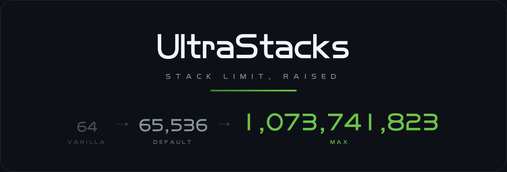

  

  
  
  
  
  

  <a href="https://github.com/zaixiayesheng/UltraStacks/releases/latest"><b>下载</b></a>
  &nbsp;&nbsp;·&nbsp;&nbsp;
  <a href="CHANGELOG.md"><b>更新日志</b></a>
  &nbsp;&nbsp;·&nbsp;&nbsp;
  <a href="https://github.com/zaixiayesheng/UltraStacks/issues"><b>问题反馈</b></a>
  &nbsp;&nbsp;·&nbsp;&nbsp;
  <a href="AI_POLICY.md"><b>贡献</b></a>
  &nbsp;&nbsp;·&nbsp;&nbsp;
  <a href="README.en.md"><b>English</b></a>

  每格默认 65536 个，开启实验性上限后可达 1,073,741,823。

---

  LGPL-3.0-only · <a href="LICENSE">LICENSE</a> · <a href="LICENSE-GPL-3.0">LICENSE-GPL-3.0</a>

